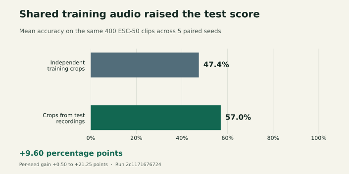
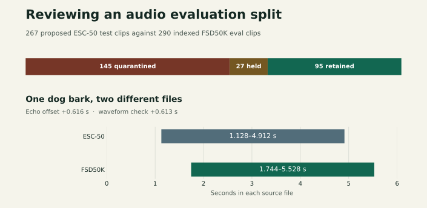

# Echo

Echo finds audio that appears in both training and test data. If a model has already heard a test clip during training, the test can overstate how well it recognizes new sounds. Echo reports candidate recordings, timestamps, and the evidence an engineer can use to review each overlap.

A five-second excerpt can come from the same recording as a longer file with a different name and encoding. Echo uses acoustic fingerprints to find shared audio and return a timestamp and matching evidence. The two datasets for the first study are ESC-50 and FSD50K. LAION has already documented overlap in their source IDs. Echo uses those IDs to measure coverage after it ranks candidates by sound. [ESC-50](https://github.com/karolpiczak/ESC-50) · [FSD50K](https://zenodo.org/records/4060432) · [LAION overlap analysis](https://github.com/LAION-AI/audio-dataset/blob/main/laion-audio-630k/ICASSP.md#potential-data-leakage)

## See Echo in use

Start with the real-audio case, the short walkthrough, or the guide for your own datasets. [Real-world case](docs/real-world-case.md) · [Video](docs/demo/echo-demo.mp4) · [Captions](docs/demo/echo-demo.vtt) · [Engineer guide](docs/demo/ENGINEER-GUIDE.md)

<!-- echo-evidence:start -->
| Measured result | Scope | Run |
| --- | --- | --- |
| **333 of 360** matching trials accepted correctly | Held-out trials across 40 positive recordings. 0 of 360 absent-source trials were accepted on this benchmark. | [Stage 3](docs/results/stage-3.md) |
| **137 of 140** confirmed pairs found at the supported offset | Independent waveform checks within the 267-query ESC-50/FSD50K eval audit. | [Stage 4](docs/results/stage-4.md) |
| **+9.60 percentage points** from deliberate training exposure | Mean accuracy rose from 47.4% to 57.0% on the same 400 test files across 5 paired runs. | [Stage 5](docs/results/stage-5.md) |
| **56% less** warm median query time | Rust voting versus tuned Python on the measured ESC-50/FSD50K sample on Apple M3. | [Stage 6](docs/results/stage-6.md) |
<!-- echo-evidence:end -->



## Real-world case study

A dataset team wants to score on ESC-50 after training with Freesound audio. Echo checks the proposed test set against indexed FSD50K recordings, supports a decision to quarantine or hold clips, and re-audits the revised test manifest. Follow a shared dog bark, a confirmed clock clip Echo missed, and an alarm pair that stayed in review. [Study, results, and reproduction](docs/real-world-case.md)



## How it works

Echo maps time-frequency peaks to integer hashes and stores them with their original times in SQLite. When a query shares hashes with a reference, their differences vote for the time offset. Echo ranks the alignments and checks how much of the query supports the top result.

## Getting started

Install [uv](https://docs.astral.sh/uv/getting-started/installation/) and use its locked environment. The project pins Python 3.12.16. The locked environment is verified on Apple Silicon macOS, Ubuntu 24.04, and Windows Server 2025.

```bash
uv sync --locked
uv run echo-audit --help
uv run echo-audit fixture --out .local/fixture
uv run --group benchmark pytest
```

The fixture writes a reference WAV, a related crop with a known sample offset, and an unrelated distractor. Use a fresh output path for each run. The command is also available as `uv run python -m echo`. The benchmark dependency group supplies FFmpeg for codec evaluation.

## Try the matcher

```bash
uv run echo-audit fixture --out .local/quickstart
uv run echo-audit index .local/quickstart/index.csv --out .local/quickstart/index.sqlite
uv run echo-audit match .local/quickstart/query.wav --index .local/quickstart/index.sqlite --json
uv run echo-audit match .local/quickstart/distractor.wav --index .local/quickstart/index.sqlite
```

The fixture's expected recording is `fixture:reference` around **+0.750 s**. The separate recording returns `no_match`. Offsets are reference time minus query time. For ESC-50 manifests, pass `--root .local/esc50` to `index`. [Stage 2 measurements and reproduction](docs/results/stage-2.md)

## Stage 1 dataset workflow

```bash
uv run echo-audit data fetch --root .local
uv run echo-audit data inventory --esc50 .local/esc50 --out .local/stage1/inventory
uv run echo-audit data audit \
  --esc50-metadata .local/esc50/meta/esc50.csv \
  --fsd50k .local/downloads/fsd50k-ground-truth.zip \
  --out .local/stage1/overlap
uv run echo-audit data spike \
  --esc50 .local/esc50 \
  --inventory .local/stage1/inventory/assets.csv \
  --out .local/stage1/spike
```

The fetch uses a roughly 616 MiB ESC-50 archive and a small FSD50K metadata ZIP. Use new output directories for reruns. See the [Stage 0 and 1 results](docs/results/stages-0-1.md) for the verified environment, reports, and output layout.

## Stage 3 benchmark

The held-out benchmark reports retrieval, accepted duplicates, absent-source controls, and results by audio transformation. [Policy, design, and trial evidence](docs/results/stage-3.md)

## Stage 4 cross-dataset audit

The ESC-50/FSD50K audit includes independent waveform checks, confirmed matches, offset disagreements, and unresolved pairs. [Cross-dataset report and evidence](docs/results/stage-4.md)

To audit your own dataset, build a reference index and pass a query manifest with the same [asset columns](src/echo/datasets.py). All runs write query decisions and ranked candidates to CSV.

```bash
uv run echo-audit index references.csv --root reference-audio --out references.sqlite
uv run echo-audit audit queries.csv --root query-audio --index references.sqlite \
  --policy docs/results/stage-3-policy.json --out .local/my-audit
```

## Stage 5 model experiment

The paired training runs keep the test set and training budget fixed. The saved predictions show how exposure changed results by seed and test slice. [Experiment report and predictions](docs/results/stage-5.md)

## Stage 6 matcher profiling

Echo uses Python by default and offers Rust offset voting through `--engine rust` for `match` and `audit`. Both engines use the same SQLite index and matching rules. [Profiles and native build instructions](docs/results/stage-6.md)

## Benchmark evidence

Run the generated fixture in CI, replay the fixed cross-dataset benchmark locally, or regenerate the published report from the ZIP with no audio download. [Report](docs/results/stage-8.md) · [Download the checksummed bundle](docs/results/echo-evidence.zip) · [Reproduction guide](docs/reproduce-evidence.md)

## Implementation stages

Follow the [numbered stages, 0 through 9](docs/stages/README.md). Start with [Stage 0, Environment and scaffold](docs/stages/00-environment-and-scaffold.md).

## Build documents

- [Build plan](docs/build-plan.md) covers shared scope, architecture, commands, and implementation decisions.
- [Evaluation protocol](docs/evaluation-protocol.md) covers the dataset audit, how to verify audio matches, and the controlled model experiment.

## Data and limitations

ESC-50 and FSD50K have separate terms and source attributions. The preview uses generated audio in the video and publishes manifests and statistics for the real datasets. [Data sources and licenses](docs/data-sources.md)

The matcher can abstain on very short, noisy or repetitive audio, and can choose a plausible offset for a different recording. The held-out suite measures cropping, MP3, resampling, added noise and gain changes. Pitch and speed edits are outside that benchmark. A clean report applies to the indexed corpus and policy. The controlled model result applies to the documented dataset, crops and classifier. [Measured failure cases](docs/results/stage-4.md#results) · [Model evidence](docs/results/stage-5.md)

[Preview release](https://github.com/iferdous/Echo/releases/tag/v0.1.0-preview.1) · [Release verification](docs/results/stage-9.md) · [Interview notes](docs/resume-bullets.md)
