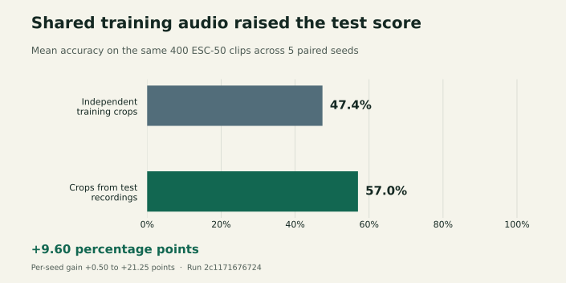

# Echo walkthrough

[Watch the 69-second walkthrough](echo-demo.mp4) · [Transcript and audio cues](echo-demo.vtt) · [Guide for your own audio](ENGINEER-GUIDE.md)

Echo finds shared audio before an evaluation split goes into a model benchmark. The walkthrough uses generated signals. The two-second crop came from a known position in a reference recording. A second sweep was generated independently as a listening control. The full-corpus clock example and ML chart come from the saved evidence. The video includes synthetic audio only.

## Reproduce the demo from a fresh checkout

```bash
uv sync --locked --group demo
uv run --no-sync python scripts/run_stage7.py --out .local/echo-demo
```

Open `.local/echo-demo/audit/review.html` in a browser. The command creates the synthetic WAVs, builds a SQLite index, runs the live CLI, checks the outcomes, and generates the accuracy chart. Pick a fresh output directory for each run.

| Input | Live result |
| --- | --- |
| `test/renamed-crop.wav` | `train:reference.wav` at **+0.752 s**, compared with the known **+0.750 s**. |
| `test/similar-control.wav` | `no_match` for the independently generated sweep. |
| `test/silence.wav` | `insufficient_evidence`, because the query has no landmarks. |

The recorded CLI arguments, stdout, JSON decisions, and published input digests are in `evidence.json`. The browser review shows which ranked candidates were accepted and displays the matched time intervals for both files. [Sample review screenshot](review-preview.png)

## Evidence behind the numbers

| Claim | Scope | Evidence |
| --- | --- | --- |
| **333/360** matching trials accepted correctly, **0/360** absent-source trials accepted | Each side used 40 held-out recordings and nine variants per source with a frozen policy. The absent-source result is specific to this benchmark. | [Stage 3 test](../results/stage-3.md) |
| **137/140** confirmed pairs found at the supported offset | Independent waveform checks confirmed 140 pairs in the 267-query ESC-50/FSD50K eval audit. The remaining three include one abstention and two timestamp disagreements. | [Stage 4 audit](../results/stage-4.md) |
| **+9.60 percentage points** mean accuracy from deliberate exposure | Same 400 ESC-50 test files and five seed pairs. Full-test gains ranged from +0.50 to +21.25 points. | [Stage 5 experiment](../results/stage-5.md) |
| **56% lower** warm median query time with optional Rust voting | Measured on Apple M3 for the 32-query cross-dataset sample versus tuned Python. Complete rankings agreed across the full 267-query replay. | [Stage 6 profile](../results/stage-6.md) |



## Render the video

The editable composition uses HyperFrames 0.9.82 and GSAP 3.14.2. Install Node.js 22 or later, Chrome or the CLI’s supported headless browser, and FFmpeg with FFprobe before rendering. The first command writes the versioned GSAP dependency into the local output directory. [HyperFrames CLI](https://hyperframes.app/docs/5-packages/cli)

```bash
npm install --prefix .local/demo-render --no-audit --no-fund --save-exact gsap@3.14.2
uv run --no-sync python scripts/prepare_stage7_video.py \
  --walkthrough .local/echo-demo \
  --gsap .local/demo-render/node_modules/gsap/dist/gsap.min.js \
  --out .local/echo-composition
npx --yes hyperframes@0.9.82 browser ensure
npx --yes hyperframes@0.9.82 lint .local/echo-composition
npx --yes hyperframes@0.9.82 render .local/echo-composition \
  --fps 24 --quality standard --workers 1 --output .local/echo-demo-render.mp4
ffmpeg -i .local/echo-demo-render.mp4 -i docs/demo/echo-demo.vtt \
  -map 0:v:0 -map 0:a:0 -map 1:s:0 -c copy -c:s mov_text \
  -metadata:s:s:0 language=eng -disposition:s:0 0 \
  -movflags +faststart .local/echo-demo-captioned.mp4
```

The shipped video used the supported headless Chrome binary with one worker after capture stalled with the desktop Chrome binary. The composition uses the live walkthrough’s recorded output and the generated chart. The reviewed example screenshot is versioned with the demo. Captions and audio cues are also available separately. [Composition source](video/index.html) · [Timed transcript](echo-demo.vtt)

The walkthrough and chart were reproduced in a fresh repository archive. The built Python wheel contains the review template. The report was checked with keyboard navigation, filters, mobile layout, and network monitoring. [Delivery receipt](delivery.json)
