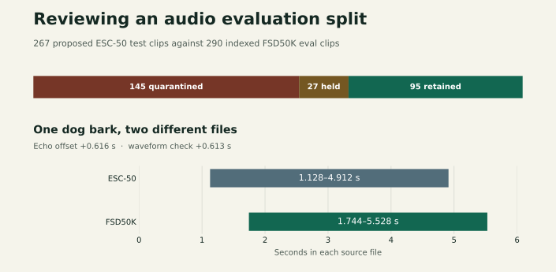

# Audit an audio test set before using it to score a model

Imagine an audio ML team wants to evaluate on ESC-50 after adding Freesound audio to training. Both datasets draw from Freesound, so renaming a file or cutting it shorter can hide audio the model may have heard. Echo gives the team a way to decide which clips to quarantine, which to review, and which to retain for further evaluation.

This case uses **267 real ESC-50 clips** as a proposed test set and **290 official FSD50K eval recordings** as a stand-in for previously seen audio. The case uses a deliberately enriched overlap cohort. The FSD50K files keep their original upstream `eval` membership. [Frozen input cohorts and acquisition](results/stage-4.md)



## What Echo found

| Check | Result | How the team can use it |
| --- | --- | --- |
| File SHA-256 join | 0 of 267 query files had identical bytes | An exact-copy check leaves this whole cohort for further review. |
| Freesound source-ID join | 171 of 267 came from an indexed source ID | Pull related recordings for review, including excerpts the acoustic matcher declines. |
| Echo acoustic audit | 165 accepted candidates across 267 queries | Inspect ranked reference IDs, offsets, and the supporting intervals. |
| Independent waveform checks | 140 confirmed clips among 171 source-linked queries | Quarantine confirmed overlap. Keep unresolved pair evidence available for review. |

The dog clip `4-207124-A-0.wav` ranked `reference-0249` first with a **+0.616 s** offset. The independent waveform check found eight matching half-second windows at **+0.613125 s**. A practitioner can compare ESC-50 at **2.500 s** with FSD50K at **3.113125 s** to hear the aligned event after downloading the source audio. [Recording and attribution](https://freesound.org/s/207124/) · [Exact match and local A/B instructions](results/stage-4.md#replay-the-dog-bark)

Two cases show why the release decision needs review. Echo abstained on a repetitive ticking clock. The source ID and four matching waveform windows at 0 s supported quarantining it. Echo accepted a different-source alarm pair at +0.032 s, but none of the waveform windows confirmed the overlap. The alarm stayed in the review queue. [Reviewed cases and exceptions](results/stage-4.md#results)

## Make the release decision and rerun

| Action | Clips | Rule |
| --- | ---: | --- |
| Quarantine | 145 | 140 waveform-confirmed clips and five other clips from confirmed source groups |
| Hold for review | 27 | 26 other unresolved source-linked clips and one unresolved accepted control |
| Retain | 95 | Controls Echo declined with no shared reference source ID |

The revised manifest contains 95 clips. Running Echo again against the same reference index and policy produced **95 `no_match` decisions**, zero accepts, and zero input errors. The replay reproduced all 475 ranked candidate rows for those clips, including declined candidates. The retained manifest covers 44 of the original 50 classes. A team that needs all 50 classes would add independently sourced replacements, freeze the updated test set, and audit again before scoring a model. The revised split is scoped to the checked reference index and policy. [Disposition of all 267 clips](results/stage-9-case/triage.csv) · [Recheck receipt](results/stage-9-case/recheck/audit.json)

The classifier study addresses a different question. With the same ordered 400 ESC-50 test clips and equal training budgets, deliberate exposure raised mean accuracy from **47.4% to 57.0%** across five paired runs. The case above changes evaluation membership. Comparing scores before and after that change would mix leakage effects with changes in what the test measures. [Controlled model experiment](results/stage-5.md)

## Reproduce

Verify the published case without fetching WAVs. The check verifies the original Stage 4 evidence, rebuilds the review decisions and proposed manifest, checks the recheck’s run ID and ranked rows, and regenerates the chart.

```bash
uv sync --locked --group demo
uv run --no-sync python scripts/run_stage9_case.py --check --out .local/stage9/case-check
```

Use the official datasets and previously verified index from the Stage 4 setup to run the audio recheck. The command writes a fresh batch and checks its decisions and rankings against the saved study. [Stage 4 dataset and index setup](results/stage-4.md#reproduce)

```bash
uv run --no-sync python scripts/run_stage9_case.py \
  --esc-root .local/esc50 --index .local/stage4/audit-run/index.sqlite \
  --out .local/stage9/case-replay
uv run --no-sync echo-audit review .local/stage9/case-replay/recheck \
  --out .local/stage9/case-replay/recheck/review.html
```

The review opens offline. The original inputs, release decisions, and tables are versioned by checksum. Runtime measurements may vary. For your own training and evaluation directories, use the generic manifest and audit workflow. [Engineer guide](demo/ENGINEER-GUIDE.md) · [Machine-readable case summary](results/stage-9-case/summary.json) · [Proposed test manifest](results/stage-9-case/proposed-test.csv) · [Data sources and terms](data-sources.md)
