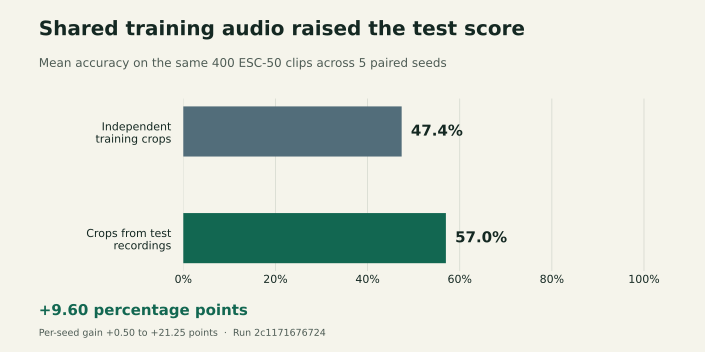
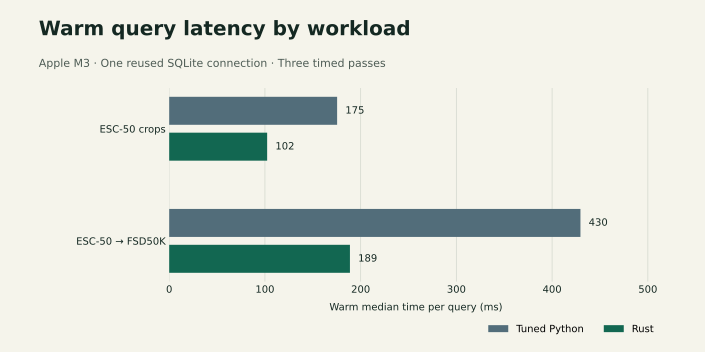

# Echo benchmark evidence

Profile **published** · Evidence run `fce91053707794482ad6a4e8546aed2be6901494c9c604a5bdaec053650fdbc4`.

The tables below regenerate from the saved per-query and per-item evidence. Corpus-specific match rates and performance measurements depend on the recorded workloads.

## Corpus metadata and development

| FSD50K partition | FSD50K clips | ESC-50 rows sharing a source ID | Shared IDs |
| --- | --- | --- | --- |
| eval | 10231 | 171 | 152 |
| train | 36796 | 399 | 374 |
| val | 4170 | 60 | 51 |

| Stage 2 fingerprint floor | Correct top 1 | Correct accepted | Accepted absent-source |
| --- | --- | --- | --- |
| global | 17/20 | 15/20 | 0/10 |
| local | 19/20 | 18/20 | 0/10 |

## Held-out matcher benchmark

Canonical run `stage-3-held-out` · Test summary SHA-256 `49f3ad1dd308bf5126025fb36cb73bb58e07005d30a0b2bbdbd58b96f194f8a6`.

Calibration accepted 336/360 positives and 0/360 absent-source trials. The table below uses the separate held-out split.

| Variant | Correct top 1 | Correct top 5 | Correct accepted | Accepted absent-source |
| --- | --- | --- | --- | --- |
| crop_1s | 39/40 | 39/40 | 38/40 | 0/40 |
| crop_2s | 39/40 | 39/40 | 38/40 | 0/40 |
| crop_4s | 39/40 | 39/40 | 38/40 | 0/40 |
| identity | 40/40 | 40/40 | 40/40 | 0/40 |
| mp3_128k | 39/40 | 39/40 | 38/40 | 0/40 |
| mp3_64k | 39/40 | 39/40 | 38/40 | 0/40 |
| noise_10db | 38/40 | 38/40 | 27/40 | 0/40 |
| quiet_24db | 38/40 | 39/40 | 38/40 | 0/40 |
| resample_8khz | 39/40 | 39/40 | 38/40 | 0/40 |
| All | 350/360 | 351/360 | 333/360 | 0/360 |

The bootstrap interval across 40 matching source groups was 85.6% to 97.5%. The absent-source trials came from 40 recordings. The Wilson 95% upper bound for a recording having any accepted trial was 8.8%.

| Baseline | Correct top 1 | Available trials | Unavailable trials |
| --- | --- | --- | --- |
| bytes | 40/360 | 720 | 0 |
| source | 180/180 | 360 | 360 |

| Source ID visibility | Correct accepted | Accepted absent-source |
| --- | --- | --- |
| visible | 168/180 | 0/180 |
| masked | 165/180 | 0/180 |

## Cross-dataset audit

Run `21351d5272b0c7d71b07a74bc127e9edcbaa89da2dc8808fea8aed0b9a3f5988` scanned 267 ESC-50 clips against 290 official FSD50K eval recordings. Waveform review covered 184 pairs and independently confirmed 140 of 171 eligible known-source pairs.

| Query cohort | Clips |
| --- | --- |
| background_control | 50 |
| same_class_control | 46 |
| shared_eval_id | 171 |

| Indexed reference cohort | Clips |
| --- | --- |
| background | 96 |
| class_distractor | 42 |
| shared_eval_id | 152 |

| Outcome | Query rows | Distinct query sources |
| --- | --- | --- |
| Known source, overlap unresolved | 31 | 30 |
| Confirmed, accepted at supported offset | 137 | 124 |
| Confirmed, offset differed | 2 | 2 |
| Confirmed, matcher abstained | 1 | 1 |
| Control declined | 95 | 95 |
| Control accepted, audio unresolved | 1 | 1 |

Distinct sources can appear in more than one outcome. An unresolved control is a candidate for review. These counts represent the selected audit cohort.

## Controlled leakage experiment

Run `2c117167672477d6faa6c8591f527ff84d17e223529a458135c6e4a348ba889b` used 1,096 examples per arm and the same ordered test clips. The comparison arm shared zero recording groups with the test set. The exposed arm shared 164 declared groups.

| Slice | Clips | Comparison | Exposed | Δ points | Source bootstrap 95% interval | Macro F1 comparison / exposed |
| --- | --- | --- | --- | --- | --- | --- |
| all | 400 | 47.4% | 57.0% | +9.60 | +7.06 to +12.35 | 0.452 / 0.552 |
| directly exposed | 164 | 50.1% | 69.4% | +19.27 | +15.24 to +23.41 | 0.475 / 0.677 |
| unexposed | 236 | 45.5% | 48.4% | +2.88 | -0.09 to +5.91 | 0.428 / 0.460 |

| Seed | Comparison correct | Exposed correct | All Δ points | Direct Δ points | Unexposed Δ points |
| --- | --- | --- | --- | --- | --- |
| 501013 | 223 | 259 | +9.00 | +23.17 | -0.85 |
| 501023 | 214 | 249 | +8.75 | +20.73 | +0.42 |
| 501031 | 213 | 247 | +8.50 | +17.68 | +2.12 |
| 501043 | 125 | 210 | +21.25 | +28.05 | +16.53 |
| 501047 | 173 | 175 | +0.50 | +6.71 | -3.81 |

Across-seed sample SD on the full test was 7.43 points. The bootstrap interval resamples test sources conditional on the trained models.

## Matcher profiling

Apple M3. Warm runs reuse a SQLite connection after a full warmup pass. Fresh runs open a connection per query. The filesystem cache was uncontrolled. The bundle preserves the noisy first ESC-50 timing pair and the repeated comparison used here.

| Workload | Engine | Warm n | Warm median ms | Warm p95 ms | Fresh n | Fresh median ms | Fresh p95 ms | Peak MiB |
| --- | --- | --- | --- | --- | --- | --- | --- | --- |
| ESC-50 crop | baseline | 90 | 112.5 | 157.4 | 30 | 104.2 | 221.0 | 137.0 |
| ESC-50 crop | tuned | 90 | 175.4 | 239.9 | 30 | 162.6 | 315.2 | 138.7 |
| ESC-50 crop | rust | 90 | 102.3 | 164.8 | 30 | 105.1 | 156.2 | 131.7 |
| ESC-50 → FSD50K | baseline | 96 | 451.1 | 997.4 | 32 | 436.2 | 958.3 | 313.0 |
| ESC-50 → FSD50K | tuned | 96 | 429.6 | 1032.4 | 32 | 432.9 | 924.3 | 313.2 |
| ESC-50 → FSD50K | rust | 96 | 188.8 | 456.5 | 32 | 196.4 | 427.5 | 250.4 |

| Workload | Indexed files | Index MiB | Median build s | Tracks/s |
| --- | --- | --- | --- | --- |
| ESC-50 crop | 200 | 35.6 | 15.71 | 12.74 |
| ESC-50 → FSD50K | 290 | 111.6 | 62.85 | 4.71 |

| Workload | Engine | Decode ms | Peaks ms | Pair ms | SQLite ms | Vote and rank ms |
| --- | --- | --- | --- | --- | --- | --- |
| ESC-50 crop | baseline | 1.5 | 1.7 | 11.4 | 40.0 | 59.2 |
| ESC-50 crop | tuned | 2.3 | 2.6 | 17.9 | 63.0 | 86.2 |
| ESC-50 crop | rust | 2.3 | 2.7 | 17.9 | 60.4 | 18.0 |
| ESC-50 → FSD50K | baseline | 3.8 | 3.4 | 19.2 | 122.5 | 304.7 |
| ESC-50 → FSD50K | tuned | 3.8 | 3.4 | 18.6 | 116.8 | 285.0 |
| ESC-50 → FSD50K | rust | 2.4 | 3.5 | 19.9 | 119.6 | 41.9 |

[Reproduction guide](https://github.com/iferdous/Echo/blob/main/docs/reproduce-evidence.md) · [Engineer workflow](https://github.com/iferdous/Echo/blob/main/docs/demo/ENGINEER-GUIDE.md)
